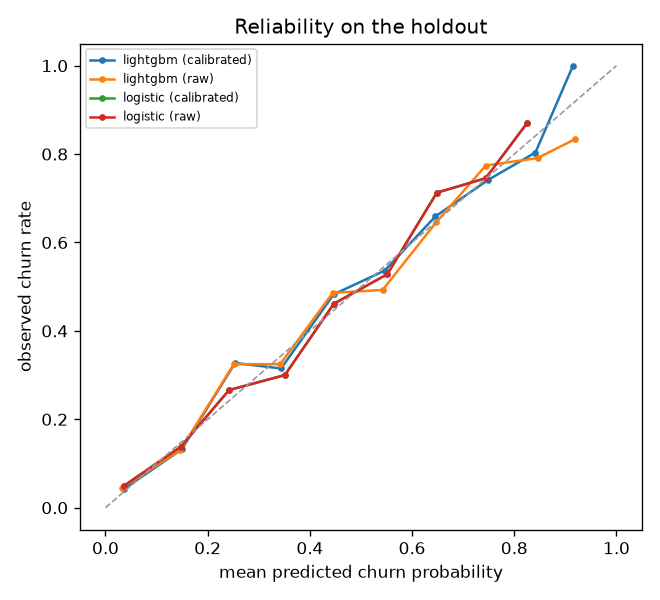
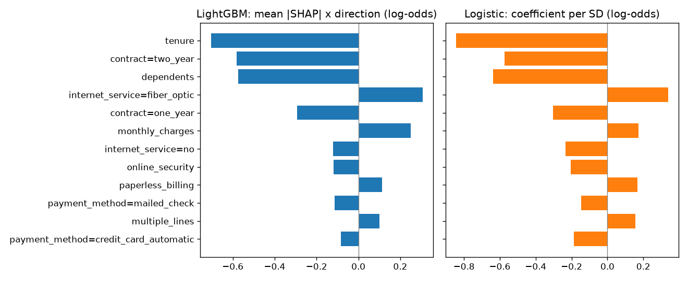

<!-- GENERATED by `telco train` - do not edit by hand. -->
# Churn models

Telco has **no time dimension** (one snapshot per customer), so there is no out-of-time test. Substitute: a stratified
holdout of 1,409 customers (26.5% churn), scored once, with bootstrap 95% CIs
(2,000 resamples), and stratified 5-fold CV on the
5,634 training customers for every choice. 22 features from `features()` (outcome-derived
fields excluded and tested, D-003; design: D-008). Decisions: D-007 to D-010.

## 1. Holdout performance

| model                 |   roc_auc | roc_auc_ci     |   pr_auc | pr_auc_ci      |   brier | brier_ci       |   log_loss |   ece |
|:----------------------|----------:|:---------------|---------:|:---------------|--------:|:---------------|-----------:|------:|
| base_rate             |     0.500 | 0.500 to 0.500 |    0.265 | 0.243 to 0.289 |   0.195 | 0.185 to 0.206 |      0.579 | 0.000 |
| rules                 |     0.669 | 0.639 to 0.696 |    0.390 | 0.351 to 0.431 |   0.173 | 0.162 to 0.185 |      0.527 | 0.010 |
| logistic (raw)        |     0.858 | 0.836 to 0.879 |    0.680 | 0.629 to 0.731 |   0.130 | 0.120 to 0.141 |      0.402 | 0.020 |
| logistic (calibrated) |     0.858 | 0.836 to 0.879 |    0.680 | 0.629 to 0.731 |   0.130 | 0.120 to 0.141 |      0.402 | 0.020 |
| lightgbm (raw)        |     0.862 | 0.842 to 0.881 |    0.679 | 0.629 to 0.729 |   0.130 | 0.119 to 0.140 |      0.398 | 0.025 |
| lightgbm (calibrated) |     0.862 | 0.842 to 0.881 |    0.679 | 0.629 to 0.729 |   0.129 | 0.119 to 0.140 |      0.397 | 0.020 |

LightGBM minus logistic regression (both calibrated), paired bootstrap on the same resamples:

| metric   |   lightgbm_minus_logistic |   ci_low |   ci_high |   share_of_resamples_lightgbm_better |
|:---------|--------------------------:|---------:|----------:|-------------------------------------:|
| roc_auc  |                     0.004 |   -0.004 |     0.012 |                                0.814 |
| pr_auc   |                    -0.001 |   -0.022 |     0.020 |                                0.486 |
| brier    |                    -0.001 |   -0.004 |     0.003 |                                0.642 |

Cross-validated (out-of-fold, training part; calibrated models calibrated by the other folds):

| model     |   roc_auc |   pr_auc |   brier |   log_loss |   ece |
|:----------|----------:|---------:|--------:|-----------:|------:|
| base_rate |     0.500 |    0.265 |   0.195 |      0.579 | 0.000 |
| rules     |     0.672 |    0.414 |   0.170 |      0.519 | 0.000 |
| logistic  |     0.855 |    0.668 |   0.132 |      0.405 | 0.013 |
| lightgbm  |     0.860 |    0.683 |   0.130 |      0.398 | 0.016 |

**Model used for targeting: lightgbm** (lowest cross-validated Brier score; calibrated probabilities matter
because targeting multiplies them by value at risk). Saved to `artifacts/churn_model.joblib`.

## 2. Calibration

Calibration method per model, chosen by cross-fitted out-of-fold Brier score (lower is better):
logistic: **none**, lightgbm: **sigmoid**.

| model    |   isotonic |    none |   sigmoid |
|:---------|-----------:|--------:|----------:|
| lightgbm |    0.12995 | 0.12982 |   0.12966 |
| logistic |    0.13208 | 0.13163 |   0.13167 |

## 3. Segments (cross-validated predictions on the training part, calibrated)

Segment AUCs are within-segment ranking quality; `mean_p` vs `churn_rate` is calibration in the segment.

By contract:

| contract       |   customers |   churners |   churn_rate |   logistic_roc_auc |   logistic_pr_auc |   logistic_mean_p |   lightgbm_roc_auc |   lightgbm_pr_auc |   lightgbm_mean_p |
|:---------------|------------:|-----------:|-------------:|-------------------:|------------------:|------------------:|-------------------:|------------------:|------------------:|
| Month-to-month |        3109 |       1332 |        0.428 |              0.766 |             0.699 |             0.428 |              0.773 |             0.716 |             0.423 |
| One year       |        1182 |        126 |        0.107 |              0.759 |             0.251 |             0.107 |              0.790 |             0.259 |             0.115 |
| Two year       |        1343 |         37 |        0.028 |              0.782 |             0.120 |             0.028 |              0.773 |             0.092 |             0.033 |

By tenure band:

| tenure_band   |   customers |   churners |   churn_rate |   logistic_roc_auc |   logistic_pr_auc |   logistic_mean_p |   lightgbm_roc_auc |   lightgbm_pr_auc |   lightgbm_mean_p |
|:--------------|------------:|-----------:|-------------:|-------------------:|------------------:|------------------:|-------------------:|------------------:|------------------:|
| 0-6           |        1208 |        638 |        0.528 |              0.764 |             0.771 |             0.471 |              0.780 |             0.792 |             0.519 |
| 7-12          |         553 |        199 |        0.360 |              0.808 |             0.697 |             0.405 |              0.812 |             0.709 |             0.359 |
| 13-24         |         820 |        233 |        0.284 |              0.826 |             0.593 |             0.340 |              0.816 |             0.574 |             0.283 |
| 25-48         |        1269 |        247 |        0.195 |              0.842 |             0.554 |             0.221 |              0.837 |             0.520 |             0.198 |
| 49-72         |        1784 |        178 |        0.100 |              0.849 |             0.434 |             0.080 |              0.851 |             0.381 |             0.104 |

By internet service:

| internet_service   |   customers |   churners |   churn_rate |   logistic_roc_auc |   logistic_pr_auc |   logistic_mean_p |   lightgbm_roc_auc |   lightgbm_pr_auc |   lightgbm_mean_p |
|:-------------------|------------:|-----------:|-------------:|-------------------:|------------------:|------------------:|-------------------:|------------------:|------------------:|
| DSL                |        1935 |        370 |        0.191 |              0.815 |             0.508 |             0.191 |              0.820 |             0.519 |             0.193 |
| Fiber optic        |        2487 |       1032 |        0.415 |              0.814 |             0.728 |             0.415 |              0.820 |             0.746 |             0.410 |
| No                 |        1212 |         93 |        0.077 |              0.842 |             0.265 |             0.077 |              0.854 |             0.321 |             0.083 |

## 4. Logistic regression: odds ratios (unpenalised, training part)

Pseudo-R² 0.306. Odds ratios > 1 raise churn odds. Tenure and monthly
charges per unit and per standard deviation (`or_per_sd`); categorical effects relative to month-to-month contract,
DSL internet and electronic check payment. **Collinearity:** the service flags explain
99.9% of the variance of monthly charges, so the separate
effects of charges, internet type and streaming services are not identifiable (wide intervals below); their joint
effect is. Read individual service odds ratios with that in mind (D-008).

| feature                                |   coef |   odds_ratio |   or_ci_low |   or_ci_high |   p_value |   or_per_sd |
|:---------------------------------------|-------:|-------------:|------------:|-------------:|----------:|------------:|
| dependents                             | -1.511 |        0.221 |       0.170 |        0.286 |     0.000 |     nan     |
| contract=two_year                      | -1.354 |        0.258 |       0.175 |        0.382 |     0.000 |     nan     |
| internet_service=fiber_optic           |  1.298 |        3.664 |       0.596 |       22.507 |     0.161 |     nan     |
| internet_service=no                    | -1.193 |        0.303 |       0.048 |        1.903 |     0.203 |     nan     |
| contract=one_year                      | -0.742 |        0.476 |       0.375 |        0.605 |     0.000 |     nan     |
| payment_method=credit_card_automatic   | -0.459 |        0.632 |       0.508 |        0.786 |     0.000 |     nan     |
| multiple_lines                         |  0.440 |        1.552 |       1.039 |        2.320 |     0.032 |     nan     |
| streaming_tv                           |  0.431 |        1.539 |       0.732 |        3.236 |     0.256 |     nan     |
| streaming_movies                       |  0.389 |        1.475 |       0.700 |        3.107 |     0.306 |     nan     |
| payment_method=mailed_check            | -0.348 |        0.706 |       0.570 |        0.874 |     0.001 |     nan     |
| paperless_billing                      |  0.340 |        1.406 |       1.192 |        1.658 |     0.000 |     nan     |
| online_security                        | -0.335 |        0.715 |       0.476 |        1.076 |     0.108 |     nan     |
| partner                                |  0.262 |        1.299 |       1.100 |        1.535 |     0.002 |     nan     |
| payment_method=bank_transfer_automatic | -0.250 |        0.779 |       0.631 |        0.961 |     0.020 |     nan     |
| tech_support                           | -0.189 |        0.827 |       0.550 |        1.244 |     0.363 |     nan     |
| phone_service                          | -0.154 |        0.857 |       0.196 |        3.750 |     0.838 |     nan     |
| senior_citizen                         |  0.111 |        1.118 |       0.931 |        1.342 |     0.234 |     nan     |
| device_protection                      |  0.067 |        1.070 |       0.717 |        1.596 |     0.742 |     nan     |
| tenure                                 | -0.034 |        0.966 |       0.961 |        0.971 |     0.000 |       0.429 |
| male                                   | -0.026 |        0.974 |       0.843 |        1.126 |     0.723 |     nan     |
| monthly_charges                        | -0.019 |        0.981 |       0.913 |        1.055 |     0.606 |       0.565 |
| online_backup                          | -0.015 |        0.985 |       0.662 |        1.465 |     0.941 |     nan     |

## 5. LightGBM SHAP vs logistic coefficients (holdout)

Spearman rank correlation of importance (mean |SHAP| vs |coefficient per SD|): **0.91**. Directions agree
for 22 of 22 features.

| feature                                |   lgbm_mean_abs_shap |   lgbm_direction |   logistic_coef_std |   lgbm_rank |   logistic_rank | direction_agrees   |
|:---------------------------------------|---------------------:|-----------------:|--------------------:|------------:|----------------:|:-------------------|
| tenure                                 |                0.705 |           -1.000 |              -0.843 |           1 |               1 | True               |
| contract=two_year                      |                0.583 |           -1.000 |              -0.573 |           2 |               3 | True               |
| dependents                             |                0.575 |           -1.000 |              -0.637 |           3 |               2 | True               |
| internet_service=fiber_optic           |                0.307 |            1.000 |               0.338 |           4 |               4 | True               |
| contract=one_year                      |                0.292 |           -1.000 |              -0.302 |           5 |               5 | True               |
| monthly_charges                        |                0.249 |            1.000 |               0.173 |           6 |              10 | True               |
| internet_service=no                    |                0.122 |           -1.000 |              -0.234 |           7 |               6 | True               |
| online_security                        |                0.118 |           -1.000 |              -0.206 |           8 |               7 | True               |
| paperless_billing                      |                0.113 |            1.000 |               0.168 |           9 |              11 | True               |
| payment_method=mailed_check            |                0.113 |           -1.000 |              -0.147 |          10 |              13 | True               |
| multiple_lines                         |                0.100 |            1.000 |               0.156 |          11 |              12 | True               |
| payment_method=credit_card_automatic   |                0.083 |           -1.000 |              -0.189 |          12 |               9 | True               |
| partner                                |                0.072 |            1.000 |               0.130 |          13 |              15 | True               |
| tech_support                           |                0.065 |           -1.000 |              -0.142 |          14 |              14 | True               |
| streaming_tv                           |                0.064 |            1.000 |               0.089 |          15 |              17 | True               |
| online_backup                          |                0.054 |           -1.000 |              -0.066 |          16 |              19 | True               |
| phone_service                          |                0.049 |           -1.000 |              -0.190 |          17 |               8 | True               |
| streaming_movies                       |                0.043 |            1.000 |               0.068 |          18 |              18 | True               |
| senior_citizen                         |                0.034 |            1.000 |               0.042 |          19 |              20 | True               |
| payment_method=bank_transfer_automatic |                0.033 |           -1.000 |              -0.104 |          20 |              16 | True               |
| male                                   |                0.029 |           -1.000 |              -0.014 |          21 |              22 | True               |
| device_protection                      |                0.025 |           -1.000 |              -0.027 |          22 |              21 | True               |

Figures: `figures/churn_reliability.png`, `figures/churn_shap_vs_logistic.png`.
