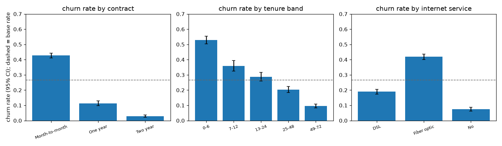

<!-- GENERATED by `telco eda` - do not edit by hand. -->
# EDA: who churns, and what that means for targeting

Source layout: **extended** (7,043 customers). Base churn rate **26.5%** (1,869 churners).
Rates carry Wilson 95% intervals and segment sizes. The data has no time dimension (one snapshot per customer).

## Contract

| contract       |   customers |   share |   churners |   churn_rate |   ci_low |   ci_high |
|:---------------|------------:|--------:|-----------:|-------------:|---------:|----------:|
| Month-to-month |        3875 |   0.550 |       1655 |        0.427 |    0.412 |     0.443 |
| One year       |        1473 |   0.209 |        166 |        0.113 |    0.098 |     0.130 |
| Two year       |        1695 |   0.241 |         48 |        0.028 |    0.021 |     0.037 |

## Tenure (months)

| tenure_band   |   customers |   share |   churners |   churn_rate |   ci_low |   ci_high |
|:--------------|------------:|--------:|-----------:|-------------:|---------:|----------:|
| 0-6           |        1481 |   0.210 |        784 |        0.529 |    0.504 |     0.555 |
| 7-12          |         705 |   0.100 |        253 |        0.359 |    0.324 |     0.395 |
| 13-24         |        1024 |   0.145 |        294 |        0.287 |    0.260 |     0.316 |
| 25-48         |        1594 |   0.226 |        325 |        0.204 |    0.185 |     0.224 |
| 49-72         |        2239 |   0.318 |        213 |        0.095 |    0.084 |     0.108 |

Contract by tenure band (churn rate):

| contract       |   0-6 |   7-12 |   13-24 |   25-48 |   49-72 |
|:---------------|------:|-------:|--------:|--------:|--------:|
| Month-to-month | 0.552 |  0.420 |   0.377 |   0.329 |   0.260 |
| One year       | 0.103 |  0.106 |   0.081 |   0.106 |   0.129 |
| Two year       | 0.000 |  0.000 |   0.000 |   0.022 |   0.033 |

Customers per cell:

| contract       |   0-6 |   7-12 |   13-24 |   25-48 |   49-72 |
|:---------------|------:|-------:|--------:|--------:|--------:|
| Month-to-month |  1413 |    581 |     737 |     802 |     342 |
| One year       |    39 |     85 |     197 |     518 |     634 |
| Two year       |    29 |     39 |      90 |     274 |    1263 |

## Internet service and add-ons

| internet_service   |   customers |   share |   churners |   churn_rate |   ci_low |   ci_high |
|:-------------------|------------:|--------:|-----------:|-------------:|---------:|----------:|
| DSL                |        2421 |   0.344 |        459 |        0.190 |    0.174 |     0.206 |
| Fiber optic        |        3096 |   0.440 |       1297 |        0.419 |    0.402 |     0.436 |
| No                 |        1526 |   0.217 |        113 |        0.074 |    0.062 |     0.088 |

Number of add-on services (security, backup, device protection, tech support, streaming TV / movies):

|   addon_services |   customers |   share |   churners |   churn_rate |   ci_low |   ci_high |
|-----------------:|------------:|--------:|-----------:|-------------:|---------:|----------:|
|                0 |        2219 |   0.315 |        475 |        0.214 |    0.197 |     0.232 |
|                1 |         966 |   0.137 |        442 |        0.458 |    0.426 |     0.489 |
|                2 |        1033 |   0.147 |        370 |        0.358 |    0.330 |     0.388 |
|                3 |        1118 |   0.159 |        306 |        0.274 |    0.248 |     0.301 |
|                4 |         852 |   0.121 |        190 |        0.223 |    0.196 |     0.252 |
|                5 |         571 |   0.081 |         71 |        0.124 |    0.100 |     0.154 |
|                6 |         284 |   0.040 |         15 |        0.053 |    0.032 |     0.085 |

Tech support:

| tech_support        |   customers |   share |   churners |   churn_rate |   ci_low |   ci_high |
|:--------------------|------------:|--------:|-----------:|-------------:|---------:|----------:|
| No                  |        3473 |   0.493 |       1446 |        0.416 |    0.400 |     0.433 |
| No internet service |        1526 |   0.217 |        113 |        0.074 |    0.062 |     0.088 |
| Yes                 |        2044 |   0.290 |        310 |        0.152 |    0.137 |     0.168 |

## Charges

Median monthly charges: churners 79.65,
stayers 64.43.

| monthly_charges_quintile   |   customers |   share |   churners |   churn_rate |   ci_low |   ci_high |
|:---------------------------|------------:|--------:|-----------:|-------------:|---------:|----------:|
| Q1 lowest                  |        1420 |   0.202 |        130 |        0.092 |    0.078 |     0.108 |
| Q2                         |        1397 |   0.198 |        349 |        0.250 |    0.228 |     0.273 |
| Q3                         |        1411 |   0.200 |        420 |        0.298 |    0.274 |     0.322 |
| Q4                         |        1407 |   0.200 |        508 |        0.361 |    0.336 |     0.386 |
| Q5 highest                 |        1408 |   0.200 |        462 |        0.328 |    0.304 |     0.353 |

## Payment and billing

| payment_method            |   customers |   share |   churners |   churn_rate |   ci_low |   ci_high |
|:--------------------------|------------:|--------:|-----------:|-------------:|---------:|----------:|
| Bank transfer (automatic) |        1544 |   0.219 |        258 |        0.167 |    0.149 |     0.187 |
| Credit card (automatic)   |        1522 |   0.216 |        232 |        0.152 |    0.135 |     0.171 |
| Electronic check          |        2365 |   0.336 |       1071 |        0.453 |    0.433 |     0.473 |
| Mailed check              |        1612 |   0.229 |        308 |        0.191 |    0.173 |     0.211 |

|   paperless_billing |   customers |   share |   churners |   churn_rate |   ci_low |   ci_high |
|--------------------:|------------:|--------:|-----------:|-------------:|---------:|----------:|
|                   0 |        2872 |   0.408 |        469 |        0.163 |    0.150 |     0.177 |
|                   1 |        4171 |   0.592 |       1400 |        0.336 |    0.321 |     0.350 |

## Senior citizens

|   senior_citizen |   customers |   share |   churners |   churn_rate |   ci_low |   ci_high |
|-----------------:|------------:|--------:|-----------:|-------------:|---------:|----------:|
|                0 |        5901 |   0.838 |       1393 |        0.236 |    0.225 |     0.247 |
|                1 |        1142 |   0.162 |        476 |        0.417 |    0.389 |     0.446 |

## A first targeting rule (the phase 2 rules baseline)

Flag **month-to-month and tenure <= 12**: 1,994 customers (28.3%); precision 51.4%
(churners among the flagged, against a base rate of 26.5%) and recall 54.8% of all churners.

## Why churners say they left (extended file; outcome-derived, never a model feature)

| churn_reason                              |   churners |   share |
|:------------------------------------------|-----------:|--------:|
| Attitude of support person                |        192 |   0.103 |
| Competitor offered higher download speeds |        189 |   0.101 |
| Competitor offered more data              |        162 |   0.087 |
| Don't know                                |        154 |   0.082 |
| Competitor made better offer              |        140 |   0.075 |
| Attitude of service provider              |        135 |   0.072 |
| Competitor had better devices             |        130 |   0.070 |
| Network reliability                       |        103 |   0.055 |
| Product dissatisfaction                   |        102 |   0.055 |
| Price too high                            |         98 |   0.052 |
| Service dissatisfaction                   |         89 |   0.048 |
| Lack of self-service on Website           |         88 |   0.047 |

These reasons exist only after a customer has left, so they are excluded from the features (D-003). They show which
themes matter: competitor offers and support attitude, which the support-text analysis (phases 5-6) examines.
