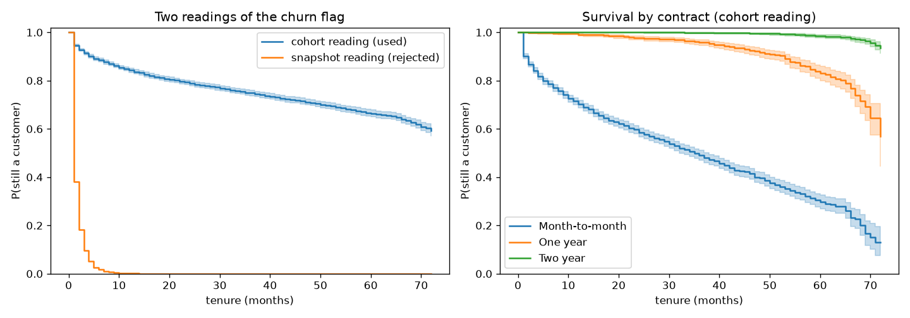
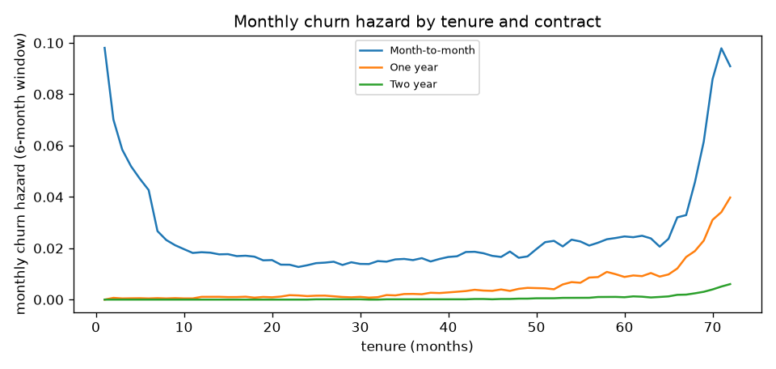

<!-- GENERATED by `telco survival` - do not edit by hand. -->
# Survival on tenure

## 0. Which reading of the data? (D-011)

IBM describes the churn flag as "left within the last month". Read literally, the data is a monthly snapshot and each
customer is at risk only in their last month (left truncation). The alternative cohort reading records churners at
the tenure at which they left and censors stayers at their current tenure. What each implies:

| quantity                                                                          |   value |
|:----------------------------------------------------------------------------------|--------:|
| monthly hazard at tenure 1 (snapshot reading: churners / customers with tenure 1) |   0.620 |
| P(reach 48 months), snapshot reading                                              |   0.000 |
| P(reach 48 months), cohort reading                                                |   0.709 |
| observed share of customers with tenure >= 49 months                              |   0.318 |
| churn rate in the data (one month, if the snapshot reading held)                  |   0.265 |

Under the snapshot reading almost no new customer would reach four years, yet a third of customers have; and a
26.5% churn rate in one month is far beyond any real telco. The snapshot reading is inconsistent with the data, so the
**cohort reading is used throughout**. IBM's customers are fictional; absolute survival figures describe this sample.

## 1. Kaplan-Meier

P(still a customer) at each tenure (months):

| curve                                      |     6 |    12 |    24 |    36 |    48 |    60 |    72 |
|:-------------------------------------------|------:|------:|------:|------:|------:|------:|------:|
| all customers                              | 0.885 | 0.843 | 0.789 | 0.749 | 0.709 | 0.664 | 0.593 |
| Month-to-month                             | 0.786 | 0.703 | 0.586 | 0.491 | 0.397 | 0.297 | 0.129 |
| One year                                   | 0.997 | 0.991 | 0.978 | 0.959 | 0.917 | 0.832 | 0.568 |
| Two year                                   | 1.000 | 1.000 | 1.000 | 0.999 | 0.996 | 0.986 | 0.936 |
| all customers, snapshot reading (rejected) | 0.017 | 0.001 | 0.000 | 0.000 | 0.000 | 0.000 | 0.000 |

Median tenure (months; `inf` where survival stays above 50% within 72 months):

| curve          |   median_tenure_months |
|:---------------|-----------------------:|
| all            |                  inf   |
| Month-to-month |                   35.0 |
| One year       |                  inf   |
| Two year       |                  inf   |

Log-rank test across contract types: statistic 2353, p = 0.

## 2. Cox proportional hazards

Covariates: the churn design matrix without tenure (tenure is the time axis). Concordance 0.869.
Hazard ratios < 1 lower the monthly churn hazard; relative to month-to-month, DSL and electronic check.

| covariate                              |   hazard_ratio |   hr_ci_low |   hr_ci_high |     p |
|:---------------------------------------|---------------:|------------:|-------------:|------:|
| contract=two_year                      |          0.081 |       0.064 |        0.103 | 0.000 |
| contract=one_year                      |          0.237 |       0.202 |        0.278 | 0.000 |
| dependents                             |          0.369 |       0.308 |        0.443 | 0.000 |
| internet_service=no                    |          0.388 |       0.300 |        0.503 | 0.000 |
| payment_method=credit_card_automatic   |          0.528 |       0.459 |        0.607 | 0.000 |
| online_security                        |          0.535 |       0.470 |        0.609 | 0.000 |
| online_backup                          |          0.543 |       0.487 |        0.605 | 0.000 |
| payment_method=bank_transfer_automatic |          0.567 |       0.496 |        0.649 | 0.000 |
| multiple_lines                         |          0.634 |       0.570 |        0.706 | 0.000 |
| tech_support                           |          0.651 |       0.573 |        0.740 | 0.000 |
| partner                                |          0.691 |       0.626 |        0.763 | 0.000 |
| device_protection                      |          0.707 |       0.633 |        0.789 | 0.000 |
| streaming_movies                       |          0.834 |       0.738 |        0.944 | 0.004 |
| senior_citizen                         |          0.897 |       0.805 |        0.999 | 0.047 |
| male                                   |          0.922 |       0.843 |        1.008 | 0.075 |
| streaming_tv                           |          0.926 |       0.819 |        1.047 | 0.219 |
| payment_method=mailed_check            |          1.000 |       0.873 |        1.145 | 0.998 |
| monthly_charges                        |          1.003 |       0.996 |        1.009 | 0.393 |
| phone_service                          |          1.013 |       0.807 |        1.273 | 0.910 |
| paperless_billing                      |          1.201 |       1.079 |        1.338 | 0.001 |
| internet_service=fiber_optic           |          1.356 |       1.103 |        1.667 | 0.004 |

### Proportional-hazards check (Schoenfeld residuals against rank of time)

11 of 21 covariates reject proportionality at 5% (their effect changes with tenure; the hazard
ratio above is then an average over tenure):

| covariate                              |   test_statistic |     p |
|:---------------------------------------|-----------------:|------:|
| contract=one_year                      |           27.423 | 0.000 |
| dependents                             |           21.154 | 0.000 |
| multiple_lines                         |           12.641 | 0.000 |
| tech_support                           |           11.704 | 0.001 |
| online_security                        |           10.221 | 0.001 |
| partner                                |           10.144 | 0.001 |
| payment_method=credit_card_automatic   |            9.500 | 0.002 |
| streaming_tv                           |            7.524 | 0.006 |
| online_backup                          |            6.709 | 0.010 |
| payment_method=bank_transfer_automatic |            5.658 | 0.017 |
| streaming_movies                       |            4.862 | 0.027 |
| device_protection                      |            2.555 | 0.110 |
| payment_method=mailed_check            |            2.288 | 0.130 |
| internet_service=fiber_optic           |            0.668 | 0.414 |
| monthly_charges                        |            0.341 | 0.559 |
| male                                   |            0.258 | 0.611 |
| senior_citizen                         |            0.162 | 0.687 |
| contract=two_year                      |            0.076 | 0.782 |
| internet_service=no                    |            0.073 | 0.788 |
| phone_service                          |            0.029 | 0.866 |
| paperless_billing                      |            0.000 | 0.999 |

### Model stratified by contract

Contract gets its own baseline hazard, so no proportionality is assumed for it. Concordance
0.729 (lower by construction: the contract effect is in the baselines, not the score).

| covariate                              |   hazard_ratio |   hr_ci_low |   hr_ci_high |     p |
|:---------------------------------------|---------------:|------------:|-------------:|------:|
| dependents                             |          0.369 |       0.307 |        0.443 | 0.000 |
| internet_service=no                    |          0.457 |       0.353 |        0.591 | 0.000 |
| payment_method=credit_card_automatic   |          0.547 |       0.476 |        0.629 | 0.000 |
| online_security                        |          0.557 |       0.490 |        0.634 | 0.000 |
| online_backup                          |          0.558 |       0.501 |        0.623 | 0.000 |
| payment_method=bank_transfer_automatic |          0.589 |       0.515 |        0.674 | 0.000 |
| multiple_lines                         |          0.642 |       0.577 |        0.715 | 0.000 |
| tech_support                           |          0.682 |       0.600 |        0.774 | 0.000 |
| partner                                |          0.712 |       0.645 |        0.786 | 0.000 |
| device_protection                      |          0.735 |       0.658 |        0.820 | 0.000 |
| streaming_movies                       |          0.863 |       0.763 |        0.976 | 0.019 |
| senior_citizen                         |          0.897 |       0.806 |        0.999 | 0.047 |
| male                                   |          0.928 |       0.849 |        1.015 | 0.103 |
| streaming_tv                           |          0.943 |       0.834 |        1.066 | 0.349 |
| monthly_charges                        |          1.002 |       0.996 |        1.009 | 0.495 |
| payment_method=mailed_check            |          1.030 |       0.899 |        1.179 | 0.673 |
| phone_service                          |          1.034 |       0.823 |        1.299 | 0.773 |
| paperless_billing                      |          1.182 |       1.062 |        1.316 | 0.002 |
| internet_service=fiber_optic           |          1.321 |       1.075 |        1.624 | 0.008 |

PH check of the stratified model:

| covariate                              |   test_statistic |     p |
|:---------------------------------------|-----------------:|------:|
| dependents                             |           27.580 | 0.000 |
| tech_support                           |           13.425 | 0.000 |
| partner                                |           11.727 | 0.001 |
| multiple_lines                         |            9.316 | 0.002 |
| online_security                        |            9.215 | 0.002 |
| payment_method=credit_card_automatic   |            9.146 | 0.002 |
| streaming_tv                           |            8.620 | 0.003 |
| streaming_movies                       |            7.165 | 0.007 |
| online_backup                          |            6.190 | 0.013 |
| payment_method=bank_transfer_automatic |            5.543 | 0.019 |
| device_protection                      |            3.282 | 0.070 |
| male                                   |            0.670 | 0.413 |
| payment_method=mailed_check            |            0.622 | 0.430 |
| senior_citizen                         |            0.326 | 0.568 |
| phone_service                          |            0.281 | 0.596 |
| monthly_charges                        |            0.267 | 0.605 |
| internet_service=no                    |            0.167 | 0.683 |
| internet_service=fiber_optic           |            0.100 | 0.752 |
| paperless_billing                      |            0.001 | 0.978 |

## 3. Expected remaining lifetime (input to customer value)

For each customer: expected months still a customer within a 24-month horizon, from the monthly hazard of
their contract type, conditional on their current tenure. Beyond 72 months the hazard is extrapolated as each
contract's pooled hazard over its last 12 observed months. Saved to `data/processed/expected_remaining_months.parquet`.

| contract       |   count |   mean |   median |   min |   max |
|:---------------|--------:|-------:|---------:|------:|------:|
| Month-to-month |    3875 |   18.9 |     19.4 |  10.5 |  20.2 |
| One year       |    1473 |   20.9 |     21.9 |  16.3 |  23.8 |
| Two year       |    1695 |   23.1 |     23.0 |  22.5 |  24.0 |
