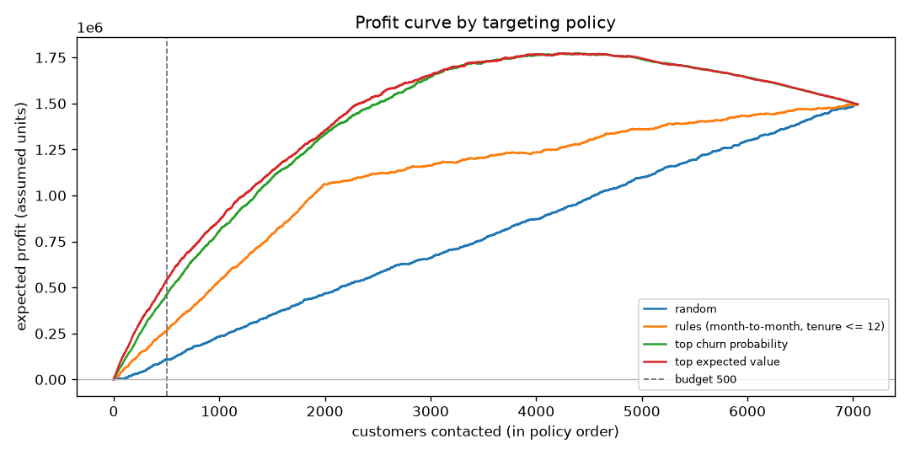

<!-- GENERATED by `telco target` - do not edit by hand. -->
# Retention targeting

**Estimates under assumptions** (`business` in `configs/config.yaml`): save rate 30%, offer cost
50, contact cost 2, backfire rate 2%, budget 500
contacts; value at risk = **cltv**. There is no treatment data: the save rate is assumed, which is why a
randomised test (section 4) is needed before any of this is trusted. Design: D-014 to D-017.

Churn probabilities are calibrated and out-of-fold for every customer (lightgbm, as chosen in phase 2), so no
customer is scored by a model that saw them. Policies rank customers on predictions; profit is scored on actual churn,
with the save and backfire rates applied in expectation.

## 1. Policies at the budget

| policy                               |   contacted |   churners_reached | precision   |   value_at_risk_reached |   expected_profit |   profit_ci_low |   profit_ci_high |
|:-------------------------------------|------------:|-------------------:|:------------|------------------------:|------------------:|----------------:|-----------------:|
| random                               |         500 |                136 | 27.2%       |                 561,310 |           109,980 |          79,595 |          134,161 |
| rules (month-to-month, tenure <= 12) |         500 |                253 | 50.6%       |               1,033,414 |           263,995 |         237,503 |          297,730 |
| top churn probability                |         500 |                415 | 83.0%       |               1,644,478 |           460,859 |         435,152 |          485,502 |
| top expected value                   |         500 |                380 | 76.0%       |               1,925,679 |           539,148 |         503,268 |          572,213 |

`profit_ci_*`: 95% bootstrap interval (1,000 resamples of customers).
4,182 customers have positive expected value; the top-EV profit curve peaks at
4,262 contacts (1,774,200), so the budget of 500 binds.

Contract mix of the 500 top-EV customers:

| contract       |   customers |
|:---------------|------------:|
| Month-to-month |         500 |

## 2. Sensitivity (profit at the budget by policy; each row re-ranks)

| scenario                    |   random |   rules (month-to-month, tenure <= 12) |   top churn probability |   top expected value |   best_contacts_top_ev |   customers_with_positive_ev |
|:----------------------------|---------:|---------------------------------------:|------------------------:|---------------------:|-----------------------:|-----------------------------:|
| base                        |  109,980 |                                263,995 |                 460,859 |              539,148 |                   4262 |                         4182 |
| save_rate = 0.1             |   -2,282 |                                 57,312 |                 131,963 |              153,304 |                   3067 |                         2814 |
| save_rate = 0.2             |   53,849 |                                160,654 |                 296,411 |              345,691 |                   3888 |                         3718 |
| save_rate = 0.4             |  166,111 |                                367,337 |                 625,307 |              733,067 |                   4542 |                         4492 |
| save_rate = 0.5             |  222,242 |                                470,678 |                 789,754 |              929,457 |                   4731 |                         4723 |
| offer_cost = 25.0           |  122,480 |                                276,495 |                 473,359 |              551,648 |                   4589 |                         4413 |
| offer_cost = 100.0          |   84,980 |                                238,995 |                 435,859 |              514,148 |                   3907 |                         3804 |
| offer_cost = 200.0          |   34,980 |                                188,995 |                 385,859 |              464,148 |                   3208 |                         3198 |
| backfire_rate = 0.0         |  142,393 |                                284,024 |                 467,343 |              552,087 |                   5705 |                         5219 |
| backfire_rate = 0.05        |   61,361 |                                233,952 |                 451,132 |              519,745 |                   3471 |                         3438 |
| value_source = clv_estimate |  -13,026 |                                   -644 |                  27,092 |               30,239 |                   1583 |                         1566 |

IBM's CLTV and the transparent CLV estimate (margin on monthly charges over expected remaining life, discounted)
correlate at 0.09; CLTV comes from an undisclosed IBM formula and is about ten times larger, so
the value source changes both the scale of the profit and who is targeted.

## 3. What to say: messages from each customer's top churn drivers

Drivers are the features with the largest positive SHAP contributions for the customer (LightGBM); the first matching
rule in `targeting.messages` picks the offer (an ASSUMPTION to be tested, not a measured effect).

| message                                    |   customers |
|:-------------------------------------------|------------:|
| Welcome call and first-year loyalty credit |         370 |
| Offer a discounted 12-month contract       |          69 |
| Fibre service check and speed guarantee    |          36 |
| Price review: plan right-sizing            |          25 |

## 4. Measuring true uplift: the randomised test

Contacting customers changes the outcome, so the save rate cannot be learned from history without a control group.
Design: take the customers the policy would contact, randomise them into treatment (contacted) and control (not
contacted), and compare churn after the campaign window. Required customers per arm to detect a given relative churn
reduction with a two-sided z-test (alpha 0.05, power
80%), at the predicted churn rate of the top-EV customers
(74.0%):

|   true_save_rate |   churn_control |   churn_treated |   customers_per_arm |   total |
|-----------------:|----------------:|----------------:|--------------------:|--------:|
|            0.050 |           0.740 |           0.703 |                2299 |    4598 |
|            0.100 |           0.740 |           0.666 |                 596 |    1192 |
|            0.200 |           0.740 |           0.592 |                 158 |     316 |
|            0.300 |           0.740 |           0.518 |                  73 |     146 |

- A 30% save rate needs about 73 customers per arm;
  smaller effects need several campaigns or a larger targeted group.
- Keep a permanent random holdout (for example 10% of each campaign) to keep measuring uplift, then fit an uplift
  model (two-model or transformed-outcome) on the test data to target persuadable customers rather than likely churners.
