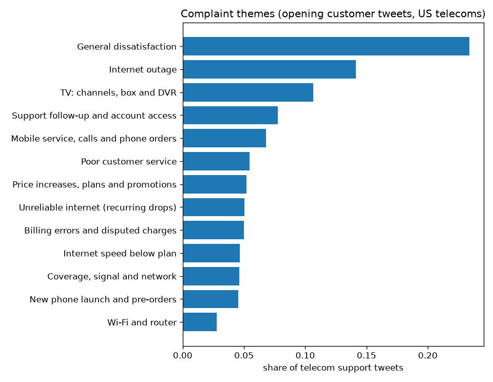

<!-- GENERATED by `telco themes` - do not edit by hand. -->
# Telecom support themes (Twitter)

Source: Kaggle `thoughtvector/customer-support-on-twitter` (real public tweets between customers and brands' support
accounts). Not linked to IBM's Telco customers (D-001): themes connect to churn drivers only through service types.

## 1. Filter, threading and cleaning (D-018)

Brands kept: the US phone and internet providers' support accounts (T-Mobile, Sprint, Verizon, AT&T, Comcast (Xfinity), Spectrum, Cox, CenturyLink), matching
IBM's US customer base. Unit: a customer's opening tweet (not a reply to anything) whose first reply came from one of
these brands, paired with that reply. Cleaning removes handles, URLs and emoji, unescapes HTML, collapses whitespace,
drops texts under 4 words and exact duplicates.

| step                                        |      rows |
|:--------------------------------------------|----------:|
| all tweets in the dataset                   | 2,811,774 |
| replies by the configured telecom brands    |   147,639 |
| customer tweets answered by a telecom brand |   139,707 |
| opening tweets (not replies to anything)    |    85,819 |
| at least 4 words after cleaning             |    83,351 |
| duplicate texts removed                     |    83,138 |

Volumes by brand (reply time = minutes from the customer tweet to the brand's first reply):

| brand             |   tweets | first                     | last                      |   median_words |   median_reply_minutes |   share |
|:------------------|---------:|:--------------------------|:--------------------------|---------------:|-----------------------:|--------:|
| Comcast (Xfinity) |    20850 | 2015-11-06 12:04:52+00:00 | 2017-12-03 22:38:05+00:00 |           18.0 |                   41.9 |     0.3 |
| T-Mobile          |    19277 | 2013-05-07 23:23:31+00:00 | 2017-12-03 22:54:05+00:00 |           19.0 |                    2.6 |     0.2 |
| Spectrum          |    16395 | 2015-04-26 20:04:03+00:00 | 2017-12-03 22:56:06+00:00 |           17.0 |                   31.7 |     0.2 |
| Sprint            |    11036 | 2011-11-28 18:39:16+00:00 | 2017-12-03 22:34:09+00:00 |           17.0 |                    9.7 |     0.1 |
| Verizon           |     6959 | 2017-05-09 23:15:56+00:00 | 2017-12-03 22:52:54+00:00 |           19.0 |                    3.2 |     0.1 |
| Cox               |     4413 | 2013-12-09 01:02:57+00:00 | 2017-12-03 21:38:10+00:00 |           18.0 |                   24.2 |     0.1 |
| CenturyLink       |     2633 | 2017-01-26 18:14:20+00:00 | 2017-12-03 21:11:57+00:00 |           19.0 |                    6.0 |     0.0 |
| AT&T              |     1575 | 2017-02-27 15:12:46+00:00 | 2017-12-03 21:14:37+00:00 |           20.0 |                   44.3 |     0.0 |

Time range: almost all tweets fall in 2017-09 to 2017-12
(83,054 of 83,138); the few earlier ones are old threads. Months with 100+ tweets:

| month   |   tweets |
|:--------|---------:|
| 2017-09 |      122 |
| 2017-10 |    39490 |
| 2017-11 |    39643 |
| 2017-12 |     3799 |

## 2. Themes (D-019)

Sentence embeddings (`sentence-transformers/all-MiniLM-L6-v2`), k-means; k chosen by silhouette on a 8,000-tweet
sample:

|   k |   silhouette |
|----:|-------------:|
|   8 |        0.026 |
|  10 |        0.028 |
|  12 |        0.027 |
|  14 |        0.028 |
|  16 |        0.026 |
|  18 |        0.027 |
|  20 |        0.029 |

k = **20**. Each cluster was labelled by reading its class-based TF-IDF terms, the 12 tweets nearest its centre
and 6 random members (`nlp.theme_labels` in config); phase 6 checks the labels against a hand-labelled sample.

Themes (clusters merged by reading):

| theme                                  |   tweets | clusters         |   share |
|:---------------------------------------|---------:|:-----------------|--------:|
| General dissatisfaction                |    19448 | 1, 3, 12, 14, 18 |   0.234 |
| Internet outage                        |    11762 | 4, 11, 13        |   0.141 |
| TV: channels, box and DVR              |     8865 | 15, 19           |   0.107 |
| Support follow-up and account access   |     6438 | 0                |   0.077 |
| Mobile service, calls and phone orders |     5635 | 6                |   0.068 |
| Poor customer service                  |     4531 | 10               |   0.054 |
| Price increases, plans and promotions  |     4335 | 8                |   0.052 |
| Unreliable internet (recurring drops)  |     4203 | 5                |   0.051 |
| Billing errors and disputed charges    |     4140 | 17               |   0.050 |
| Internet speed below plan              |     3874 | 2                |   0.047 |
| Coverage, signal and network           |     3843 | 16               |   0.046 |
| New phone launch and pre-orders        |     3767 | 9                |   0.045 |
| Wi-Fi and router                       |     2297 | 7                |   0.028 |

Clusters with their class-based TF-IDF terms:

|   cluster | theme                                  |   tweets |   median_words |   share | top_terms                                                                                                  |
|----------:|:---------------------------------------|---------:|---------------:|--------:|:-----------------------------------------------------------------------------------------------------------|
|        18 | General dissatisfaction                |     7836 |         12.000 |   0.094 | shit, guys, really, just, like, hey, fuck, hate                                                            |
|         0 | Support follow-up and account access   |     6438 |         18.000 |   0.077 | help, account, dm, email, website, need, trying, issue                                                     |
|         6 | Mobile service, calls and phone orders |     5635 |         21.000 |   0.068 | phone, calls, service, number, help, new, phones, just                                                     |
|        15 | TV: channels, box and DVR              |     5352 |         18.000 |   0.064 | watch, channel, channels, game, tv, demand, stream, episode                                                |
|         4 | Internet outage                        |     4610 |         16.000 |   0.055 | internet, modem, connection, going, working, issues, hours, having                                         |
|        13 | Internet outage                        |     4587 |         14.000 |   0.055 | outage, area, outages, internet, internet outage, service, eta, zip                                        |
|        10 | Poor customer service                  |     4531 |         19.000 |   0.054 | customer, customer service, service, worst, worst customer, customers, company, experience                 |
|         8 | Price increases, plans and promotions  |     4335 |         21.000 |   0.052 | month, plan, pay, price, paying, free, customers, new                                                      |
|         3 | General dissatisfaction                |     4222 |         16.000 |   0.051 | service, services, sucks, worst service, service sucks, worst, shitty, going                               |
|         5 | Unreliable internet (recurring drops)  |     4203 |         18.000 |   0.051 | internet, internet service, fucking, pay, day, shit, service, worst                                        |
|        17 | Billing errors and disputed charges    |     4140 |         22.000 |   0.050 | pay, credit, account, month, payment, billing, charged, paid                                               |
|         2 | Internet speed below plan              |     3874 |         18.000 |   0.047 | speed, speeds, mbps, slow, download, upload, internet, pay                                                 |
|        16 | Coverage, signal and network           |     3843 |         19.000 |   0.046 | spectrum, lte, signal, service, coverage, network, verizon, data                                           |
|         9 | New phone launch and pre-orders        |     3767 |         20.000 |   0.045 | iphone, order, iphonex, pre, preorder, upgrade, pixel, phone                                               |
|        19 | TV: channels, box and DVR              |     3513 |         20.000 |   0.042 | cable, tv, box, dvr, cable box, channels, watch, app                                                       |
|         1 | General dissatisfaction                |     2941 |         19.000 |   0.035 | comcast, xfinity, cable, internet, service, comcast xfinity, comcastoutage, time                           |
|        14 | General dissatisfaction                |     2931 |         21.000 |   0.035 | mobile, tmobile, tmobiletuesdays, phone, customer, help, tuesday, service                                  |
|        11 | Internet outage                        |     2565 |         14.000 |   0.031 | mobile_care, mobile_carexi, mobile_carexi internet, internet, modem, working, outage, mobile_care internet |
|         7 | Wi-Fi and router                       |     2297 |         17.000 |   0.028 | wifi, router, fi, wi fi, wi, working, fix, work                                                            |
|        12 | General dissatisfaction                |     1518 |         20.000 |   0.018 | sprint, service, phone, customer, store, sprint customer, sprint store, customer service                   |

Examples nearest each centre:

**General dissatisfaction** (7,836 tweets): “YOU FUCKING SUCK!!!!! Y’all should just shut down” · “We are tired!! You have 48 hours to correct our issues or we will drop you!! This has gone on too long!! Customer for 22 years.” · “Y'all got me so bent tryna take away all my damn shows and not let me get ahold of nobody as I've been trying to call all day” · “Screw you down again for like the umpteenth time in. Month! #charteroutage #”

**Support follow-up and account access** (6,438 tweets): “hey, you told people having issue to dm you phone number and I have about 9 minutes ago, no response please fix our net! We have none” · “My account seems to have been hijacked. Support is reluctantly looking into it and I should call back in 7-10 business days. Ouch.” · “shame on you. We cannot sign onto internet and the person who is SUPPOSE to help is NO help. Where is your customer service” · “n still no help....mind u I was suppose to get a follow up call for my issue almost 2 weeks ago...I regret the day I signed up”

**Mobile service, calls and phone orders** (5,635 tweets): “your customer is crap and we are about to switch to or for new cellphone service. I am tired of poor service.” · “your company is the worst. Ordered a phone. It was lost, replaced the order and only took 4 hours on the phone to do this.” · “& please do something about your cellphone service, causing a lot of problems since my calls & texts aren't being sent or received!” · “Either gone get better service or I’m changing phone companies, I been with them too long for it to act like this”

**TV: channels, box and DVR** (5,352 tweets): “what is the deal...every channel works except the one that I want to watch ...time to start looking for other service. Too many problems...t” · “Tried to why their service sucks and they tried telling me it’s my tv. Well it must be everyone else’s too today. We just want to watch the ” · “Why all the channels off air ?!?” · “what's going on with the channels?”

**Internet outage** (4,610 tweets): “Is there another outage? Why is my internet messing up?” · “Third time this week my internet stops working... this time not because of an outage.” · “Internet has been down for a couple hours, resetting modem hasn't worked, any known outages in my area? Pleasant Prairie, WI.” · “is internet service down?”

**Internet outage** (4,587 tweets): “, Outage in my area any update?” · “is there an outage in my area?” · “is there an outage happening?” · “any eta or cause for the outage in my area? All 3 services are down.”

**Poor customer service** (4,531 tweets): “your customer service is the worst that I have ever experienced!” · “literally the worst customer service I have ever experienced just now. it is insane that your company is so bad as this.” · “your company has the worst customer service ever” · “I am BEYOND done with worst customer service I’ve ever experienced..”

**Price increases, plans and promotions** (4,335 tweets): “Thanks for the jacked up bill, . Didn’t even know we were previously on a promotional rate. Maybe WARN customers when their bill’s about to ” · “Price of "bundled services" rose $15 in two months? Now paying $106 for Internet (no cable). I'll be in touch about canceling my service #ri” · “...why are you raising the bill on faithful customers and offering discounts to new people. You need to treat your loyal customers better! A” · “$50 per month 10gig .I'm always out anyway poor Customer service. Who plan better I need to switch &t or”

**General dissatisfaction** (4,222 tweets): “Why is my service soooo bad !!!” · “wtf is going on with your service?” · “what in the hell is wrong with my service?!??” · “my service sucks and i'm mad about it”

**Unreliable internet (recurring drops)** (4,203 tweets): “Congratulations , you're officially the worst internet service I've had the displeasure of using. I can't go 3 days without an outage, and w” · “Today I switched from to for my internet needs. I'm tired of the poor service provided by and they're even worse customer support provided b” · “Hate that all the money we shell out for internet and it’s still crap. Goes out at least once a week despite their “efforts” to get it fixed” · “I’ve had internet for like 3 months and I am so fucking done with their outages and poor internet service”

**Billing errors and disputed charges** (4,140 tweets): “You people need to correct my bill immediately. I was told to find service elsewhere, and I did. Now I'm being billed for 2 months for servi” · “is full of shit. The customer service sucks! I have talked to 8 different people who promised to change my damn bill and it’s still the same” · “fucked my bill up for 3months and have the nerve to NOT have a direct phone for billing y’all suck!!” · “you over billed me this month and I spent an hour on the phone being told my only option is to pay the amount I don't owe and get refunded n”

**Internet speed below plan** (3,874 tweets): “I have blast internet and am getting 1mb speeds. What's going on? Lombard il” · “Can you guys explain this to me? Althou I’m paying for 300mbps... 3 weeks in row and I’m having the same problem the same slow speed... it’s” · “I've been experiencing really slow internet speeds today. I pay for the 100 mbps and currently been experiencing 2 mbps (modem only” · “Ive got the blast 200Mbps, my internet has barely been breaking 10Mbps for the last day on internet speed tests”

**Coverage, signal and network** (3,843 tweets): “you have the worst service. Why does cellular work better than my #Spectrum internet? You’re horrible. I didn’t think it could get worse but” · “Spectrum internet sucks!! Might as well be using dial up!” · “Spectrum tech cut our internet to connect our neighbor. We can't wait a week for next available appointment. This is not ok!” · “your service is horrible. My internet and home phone service have been going in and out for weeks. It is time to cancel everything with you.”

**New phone launch and pre-orders** (3,767 tweets): “trying to get my iPhone X had been a pain. I preordered on the 27 of October all for someone on your end to cancel my order today.” · “When is getting the IPhone X I'm trying to get mine asap other retail companies already have it in stock I'm switching to” · “MY IPHONE X MIGHT NOT GET HERE UNTIL A WEEK FROM NOW i pre-ordered it on Oct. 27th tho dudes wth” · “iPhone X pre order is Friday , where’s the info”

**TV: channels, box and DVR** (3,513 tweets): “why is your tv app so glitchy? On demand on the cable box is even worse. We pay way to much for such unreliable service.” · “I have been having issues with my cable box. The channel would go out and take forever to come back on” · “why is cable out again? 2nd time this week. Glad I have and not your DVR so at least I can still watch stuff, since the internet is out alon” · “so upset with your service my cable literally goes out once a week, cable guy was here last Wednesday to fix it & it just went out”

**General dissatisfaction** (2,941 tweets): “#comcast is absolutely horrible. Never go with them. Had no service for 7 weeks, now they want me to pay for those weeks. What a joke!!” · “#Comcast outage once again...sigh” · “I swearrrr I hate Comcast. My internet has been acting up all week. This is seriously a pain in my ass.” · “#comcast must have another outage. No internet or cable this time. Half hour so far......”

**General dissatisfaction** (2,931 tweets): “I am so disgusted with #Tmobile for their lack of customer service. I have reached out for help but no reply.” · “Hey ... I have a huge problem with your T Mobile customer service” · “I can not believe after being with T-Mobile for over 10 years, the customer service I have received today is astonishing & horrible! I will ” · “Terrible first day experience with T-Mobile!! Just emailed the store manager. (a portion of the end of the email) #TMobile”

**Internet outage** (2,565 tweets): “#mobile_Care Once again my Internet service is down” · “#mobile_Care Internet is down again and scheduled to be fixed in about 5 hours...” · “#mobile_Care I am having problem with my internet.” · “#mobile_Care Internet trouble. Help.”

**Wi-Fi and router** (2,297 tweets): “Wi-Fi is messing up when I need it the most. sucks” · “Seriously, WiFi is always giving me problems.” · “I need my wifi fixed like every other day, ..... What the fuck.” · “I’m a need y’all come fix my connection y’all WiFi is absolute garbage!”

**General dissatisfaction** (1,518 tweets): “So frustrated with #Sprint. I tell them the cell service is bad & they say no it is good and strong. It's your phone.” · “do not use #sprint, they are criminals ... they have now stolen upwards of 600$ from me, they won't cancel my service, even though it doesn'” · “your customer service over the phone suck! I have been with sprint since 2006 and this is a disgrace!” · “#Sprint....WORST SERVICE PROVIDERS EVER!!! Do not ever switch to them!!!”

Theme mix by brand (column shares):

| theme                                  |   AT&T |   CenturyLink |   Comcast (Xfinity) |   Cox |   Spectrum |   Sprint |   T-Mobile |   Verizon |
|:---------------------------------------|-------:|--------------:|--------------------:|------:|-----------:|---------:|-----------:|----------:|
| Billing errors and disputed charges    |  0.078 |         0.057 |               0.039 | 0.048 |      0.029 |    0.060 |      0.067 |     0.061 |
| Coverage, signal and network           |  0.058 |         0.031 |               0.012 | 0.018 |      0.063 |    0.073 |      0.061 |     0.049 |
| General dissatisfaction                |  0.253 |         0.162 |               0.241 | 0.139 |      0.141 |    0.353 |      0.291 |     0.165 |
| Internet outage                        |  0.052 |         0.131 |               0.238 | 0.255 |      0.245 |    0.020 |      0.019 |     0.095 |
| Internet speed below plan              |  0.026 |         0.114 |               0.058 | 0.075 |      0.060 |    0.019 |      0.024 |     0.049 |
| Mobile service, calls and phone orders |  0.125 |         0.041 |               0.022 | 0.023 |      0.016 |    0.138 |      0.119 |     0.097 |
| New phone launch and pre-orders        |  0.078 |         0.001 |               0.001 | 0.001 |      0.001 |    0.092 |      0.129 |     0.015 |
| Poor customer service                  |  0.095 |         0.086 |               0.040 | 0.034 |      0.029 |    0.092 |      0.063 |     0.068 |
| Price increases, plans and promotions  |  0.069 |         0.048 |               0.035 | 0.055 |      0.036 |    0.055 |      0.078 |     0.060 |
| Support follow-up and account access   |  0.070 |         0.072 |               0.052 | 0.068 |      0.045 |    0.071 |      0.125 |     0.120 |
| TV: channels, box and DVR              |  0.043 |         0.038 |               0.166 | 0.150 |      0.202 |    0.008 |      0.011 |     0.141 |
| Unreliable internet (recurring drops)  |  0.033 |         0.167 |               0.062 | 0.098 |      0.092 |    0.009 |      0.006 |     0.038 |
| Wi-Fi and router                       |  0.020 |         0.052 |               0.036 | 0.035 |      0.042 |    0.009 |      0.008 |     0.042 |
