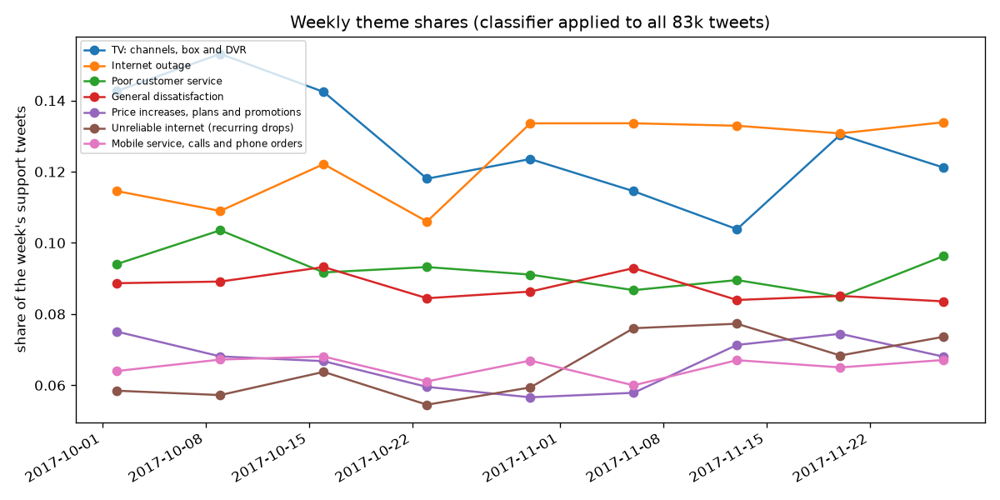

<!-- GENERATED by `telco classify` - do not edit by hand. -->
# From complaint themes to churn drivers

The Twitter data and IBM's customers are **not linked** (D-001): nothing below joins a tweet to a customer. The two
meet only at the level of churn drivers: what telecom customers complain about in public, what IBM's churners say made
them leave, and how churn differs for customers with the related service.

## 1. Theme volumes, sentiment and urgency (all 83,138 tweets, classifier predictions)

| theme                                       |   tweets |   negative |   urgent |   share |
|:--------------------------------------------|---------:|-----------:|---------:|--------:|
| TV: channels, box and DVR                   |    10597 |      0.689 |    0.124 |   0.127 |
| Internet outage                             |    10290 |      0.347 |    0.946 |   0.124 |
| Poor customer service                       |     7704 |      0.937 |    0.228 |   0.093 |
| General dissatisfaction                     |     7277 |      0.963 |    0.197 |   0.088 |
| Price increases, plans and promotions       |     5470 |      0.676 |    0.164 |   0.066 |
| Mobile service, calls and phone orders      |     5419 |      0.662 |    0.190 |   0.065 |
| Unreliable internet (recurring drops)       |     5415 |      0.825 |    0.665 |   0.065 |
| Internet speed below plan                   |     5286 |      0.808 |    0.128 |   0.064 |
| Billing errors and disputed charges         |     5233 |      0.844 |    0.155 |   0.063 |
| Support follow-up and account access        |     4943 |      0.397 |    0.173 |   0.059 |
| Coverage, signal and network                |     4939 |      0.662 |    0.539 |   0.059 |
| Other (not a complaint, unclear, off-topic) |     4080 |      0.304 |    0.077 |   0.049 |
| New phone launch and pre-orders             |     3533 |      0.455 |    0.031 |   0.042 |
| Wi-Fi and router                            |     2952 |      0.497 |    0.372 |   0.036 |

Weekly theme shares (weeks with 500+ tweets):

| week       |   TV: channels, box and DVR |   Internet outage |   Poor customer service |   General dissatisfaction |   Price increases, plans and promotions |   Unreliable internet (recurring drops) |   Mobile service, calls and phone orders |
|:-----------|----------------------------:|------------------:|------------------------:|--------------------------:|----------------------------------------:|----------------------------------------:|-----------------------------------------:|
| 2017-10-02 |                       0.143 |             0.115 |                   0.094 |                     0.089 |                                   0.075 |                                   0.058 |                                    0.064 |
| 2017-10-09 |                       0.153 |             0.109 |                   0.104 |                     0.089 |                                   0.068 |                                   0.057 |                                    0.067 |
| 2017-10-16 |                       0.142 |             0.122 |                   0.092 |                     0.093 |                                   0.067 |                                   0.064 |                                    0.068 |
| 2017-10-23 |                       0.118 |             0.106 |                   0.093 |                     0.084 |                                   0.060 |                                   0.055 |                                    0.061 |
| 2017-10-30 |                       0.124 |             0.134 |                   0.091 |                     0.086 |                                   0.057 |                                   0.059 |                                    0.067 |
| 2017-11-06 |                       0.115 |             0.134 |                   0.087 |                     0.093 |                                   0.058 |                                   0.076 |                                    0.060 |
| 2017-11-13 |                       0.104 |             0.133 |                   0.090 |                     0.084 |                                   0.071 |                                   0.077 |                                    0.067 |
| 2017-11-20 |                       0.130 |             0.131 |                   0.085 |                     0.085 |                                   0.074 |                                   0.068 |                                    0.065 |
| 2017-11-27 |                       0.121 |             0.134 |                   0.096 |                     0.084 |                                   0.068 |                                   0.074 |                                    0.067 |

## 2. Themes and churn drivers (D-022)

`tweet_share`: share of support tweets in the driver's themes. `ibm_churn_reason_share`: share of IBM's 1,869 churners
giving a reason in that driver. `churn_rate_with/without`: IBM churn for customers with and without the related feature.

| driver                                        |   tweet_share |   tweet_share_negative |   ibm_churn_reason_share | telco_feature                     |   churn_rate_with |   churn_rate_without |   customers_with |
|:----------------------------------------------|--------------:|-----------------------:|-------------------------:|:----------------------------------|------------------:|---------------------:|-----------------:|
| Reliability (outages, drops, Wi-Fi, coverage) |         0.284 |                  0.154 |                    0.055 | internet_service = Fiber optic    |             0.419 |                0.145 |         3096.000 |
| Speed                                         |         0.064 |                  0.051 |                    0.125 | internet_service = Fiber optic    |             0.419 |                0.145 |         3096.000 |
| Price, plans and billing                      |         0.129 |                  0.098 |                    0.268 | payment_method = Electronic check |             0.453 |                0.171 |         2365.000 |
| Customer service and support access           |         0.152 |                  0.110 |                    0.243 | tech_support = No                 |             0.416 |                0.118 |         3473.000 |
| Devices and phone service                     |         0.108 |                  0.062 |                    0.070 | phone_service = 1                 |             0.267 |                0.249 |         6361.000 |
| TV and range of services                      |         0.127 |                  0.088 |                    0.024 | streaming_tv = Yes                |             0.301 |                0.243 |         2707.000 |
| General dissatisfaction                       |         0.088 |                  0.084 |                    0.102 | nan                               |           nan     |              nan     |          nan     |
| Not addressable / other                       |         0.049 |                  0.015 |                    0.114 | nan                               |           nan     |              nan     |          nan     |

Reading: the drivers that dominate public complaints (reliability, TV) are not the ones IBM's churners name most
(price and competitor offers, customer service); customer service is large in both. Shares are not comparable as
rates: tweets over-represent acute, visible failures, and churn reasons are what a leaving customer chose from a list.
